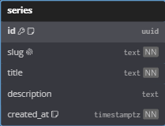
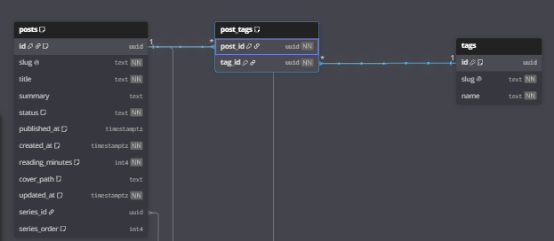

> ⚠️ **Aviso:** ¡Saludos! Paso por aquí a darte un pequeño aviso. Para disfrutar y entender este post adecuadamente lo ideal es que hayas leído sus antecesores en la serie, debido a que es la continuación del caso de estudio que llevamos con anterioridad. Además de ello, veremos un poco de SQL básico; este no es un limitante, pero lo ideal es tener alguna noción de antemano. Con eso en mente, espero que te sea de ayuda.

## **MR:**

En el modelo relacional se define lo siguiente:

1. Tablas y sus columnas.
2. Relaciones.

A mi parecer MR es la parte más sencilla del trabajo, y gran parte de esto se debe al hecho de haber realizado un excelente trabajo en su predecesor, el MER. Vamos a entender las razones a continuación, así que manos a la obra.

---

### Tablas y columnas

Es interesante crear la analogía de que las tablas y columnas son simplemente una traducción de las entidades y atributos de un MER. Pensémoslo así: `tablas = entidades`, `columnas = atributos` y `relaciones N:M = tablas intermedias`. Esto nos sirve como una abstracción lógica para aprender.

En nuestro caso de estudio tenemos las siguientes tablas:

- `newsletter_deliveries`.
- `subscribers`.
- `newsletter_sends`.
- `post_sources`.
- `post_tags`.
- `posts`.
- `tags`.
- `series`.

Me parece que son muchas tablas para ejemplificar, entonces en esta sección de creación usaremos solo una: `series`.

> Esta tabla no fue escogida al azar, de hecho es el mejor caso para este paso, esto debido a que no contiene foreign keys ni es una tabla intermedia; no queremos complicarnos con eso actualmente.



Esto es tan simple como entender el tipo de información que va a almacenar cada columna de tu tabla. En mi caso, desde el MER había definido estos atributos; aquí solo definimos los tipos de datos y las restricciones asociadas a ellos.

- `id`: es la primary key de la tabla y usa `UUID`, que es simplemente lo que dice su nombre, un identificador único universal (*Universally Unique Identifier*). Lo elijo porque se puede generar desde cualquier lado sin riesgo de que se repita y porque no deja ver cuántos registros tengo ni adivinar el siguiente, algo que sí pasa con un `1, 2, 3...`. Aun así, usar un entero autoincremental (`SERIAL` o `GENERATED ALWAYS AS IDENTITY` en PostgreSQL) también es válido.
- `slug`, `title` y `description`: los tres usan `TEXT`. En el caso del [slug](https://developer.mozilla.org/es/docs/Glossary/Slug) no deseo limitar su longitud, ya que este va asociado al title de mis series, y si el title no tiene límite el slug tampoco debería tenerlo; la descripción lleva consigo la misma lógica. Dato curioso, en PostgreSQL `TEXT` y `VARCHAR(n)` rinden igual, así que no pierdes nada al no ponerle un límite.
- `created_at`: esta es una columna especial porque existe en la mayoría de mis tablas, y de hecho es una buena práctica tenerla en nuestras tablas: permite tener una mejor trazabilidad sobre lo acontecido en los datos almacenados. Elegí `TIMESTAMPTZ` en lugar de un simple `TIMESTAMP` porque guarda un instante absoluto, convertido a UTC y con precisión de microsegundos, y al consultarlo lo devuelve en la zona horaria de quien pregunta. Ojo, no es que guarde la zona horaria como tal, lo que guarda es el instante; en cambio un `TIMESTAMP` sin zona es ambiguo, ¿las 3:00 p. m. de dónde? Algo importante cuando deseo mostrar información de fechas a usuarios en distintas zonas horarias.
- `NOT NULL`: `slug`, `title` y `created_at` son columnas que no permiten valores nulos, y esto porque toda serie debe tener esas características, mientras que `description` no tiene esta restricción debido a que no planeo que todas mis series cuenten con una. `id` no lo necesita, porque toda primary key ya es `NOT NULL` por naturaleza.
- `UNIQUE`: el slug va en la URL de cada serie (`/series/:slug`), así que dos series no pueden compartirlo, por eso lleva esta restricción. Sin ella podría tener dos series peleándose por la misma dirección.

Todo esto, llevado a SQL, se ve así:

```sql
CREATE TABLE series (
  id          UUID PRIMARY KEY DEFAULT gen_random_uuid(),
  slug        TEXT NOT NULL UNIQUE,
  title       TEXT NOT NULL,
  description TEXT,
  created_at  TIMESTAMPTZ NOT NULL DEFAULT now()
);
```

> Aclaro que `gen_random_uuid()` y `now()` son valores por defecto, es decir, si al insertar una serie no envío el id o la fecha, PostgreSQL los genera por mí.

Se puede notar que la elección de cada tipo de dato depende del uso que se le va a dar a cada dato almacenado en la columna; no es cuestión de gustos. El consejo que doy es investigar el tipo de dato más útil dependiendo de nuestro contexto, la industria siempre tiene un estándar.

---

### Relaciones

Aquí viene lo bueno, es donde empezamos a ver todo lo referente a las foreign keys. Todo se resume en una pregunta: ¿en cuál de mis tablas debo poner mi foreign key? Sencillo, dependemos de la cardinalidad que llevamos definida en el MER. Los casos posibles son:

- **N:1 / 1:N**: aquí es simple, la foreign key va dentro de la tabla del lado N. ¿Por qué? Porque cada registro del lado N necesita saber a qué registro del lado 1 pertenece.
- **1:1**: la foreign key va en la tabla que depende de la otra, y lleva `UNIQUE` para que la relación no termine convirtiéndose en un 1:N. En nuestro caso de estudio, un registro de `post_sources` no tiene sentido sin su post, así que es él quien guarda el `post_id`, de hecho lo usa como su propia primary key; y `newsletter_sends` guarda un `post_id` con `UNIQUE`, porque un post solo se envía una vez.
- **N:M**: en el MER sí existe, pero en el MR nunca la veremos como tal, porque como ya mencionamos en el [post anterior](/post/modelo-entidad-relacion), esta relación se transforma en una tabla intermedia que almacena las foreign keys de sus tablas adyacentes.



Este es un buen ejemplo. La relación N:M entre `posts` y `tags` se transformó en la tabla intermedia `post_tags`, y algo interesante, esa relación muchos a muchos terminó convertida en dos relaciones 1:N, una de `posts` hacia `post_tags` y otra de `tags` hacia `post_tags`. Además, `post_tags` tiene como primary key la combinación `(post_id, tag_id)`, a esto se le llama primary key compuesta, y es lo que evita que un post tenga el mismo tag dos veces. La relación 1:N con `series` no alcanza a verse en la imagen, pero ahí está: es la foreign key `series_id` dentro de `posts`, que va del lado N tal como dijimos.

¿Recuerdas que en el MER algunas relaciones tenían atributos?, aquí es donde cobran sentido:

- `series_order`, que en el MER vivía en la relación `belongs_to`, ahora es una columna de `posts`, tal como lo anticipamos; se puede ver en la imagen junto a `series_id`.
- `newsletter_deliveries`, al ser N:M, se convirtió en una tabla intermedia, y sus atributos (`status`, `error` y `attempted_at`) pasaron a ser columnas de ella, junto a las foreign keys `send_id` y `subscriber_id`.

> Un tip: en el MER pueden aparecer atributos compuestos, es decir, atributos formados por otros más pequeños, por ejemplo una `direccion` compuesta por `calle` y `ciudad`. Lo mejor es dejarlos en la tabla de la que nacen, pero descompuestos en columnas simples. Ojo, no hay que confundirlos con los atributos multivaluados (los que pueden tener varios valores a la vez, como varios teléfonos); esos sí van a su propia tabla, porque guardarlos en una sola columna violaría la 1FN.

---

## Normalización

La normalización no es más que el proceso de reducir la redundancia, y con ella los problemas al insertar, actualizar o borrar datos, a través de las formas normales. Ahora, si llegaste hasta aquí, te felicito: has logrado entender el *mindset* que utilizo para llevar a cabo el modelado de bases de datos. Sin embargo, este no es el fin de tu camino, pero sí el de esta serie. En el [primer post](/post/entendiendo-el-modelado-de-bases-de-datos) la presenté como la tercera fase y lo sigue siendo, pero la normalización, una vez entendida, se vuelve más un asunto de práctica y costumbre, y explicar cada forma normal daría para una serie completa. Por ello el alcance de esta serie llega hasta aquí, pero no sin antes regalarte un recurso que me ha servido personalmente para estudiar las formas normales.

[Normalización en SQL (1NF - 5NF): Guía para principiantes](https://www.datacamp.com/es/tutorial/normalization-in-sql)

---

## Antes de irte

Leer hasta aquí demuestra que te ha interesado o que tienes curiosidad por mi contenido, algo que de verdad agradezco. No pierdas el hilo: suscríbete para mantenerte al día en esta aventura. Nada de *bullshit*, solo información relevante. Además, un comentario con buen feedback nunca está de más. 🚀

## Referencias

1. Codd, E. F. (1970). A Relational Model of Data for Large Shared Data Banks. *Communications of the ACM*, 13(6), 377–387. [https://doi.org/10.1145/362384.362685](https://doi.org/10.1145/362384.362685)
2. Elmasri, R., & Navathe, S. B. (2016). *Fundamentals of Database Systems* (7.ª ed.). Pearson. Capítulos 9 (mapeo de ER a relacional) y 14 (dependencias funcionales y normalización). [Pearson](https://www.pearson.com/en-us/subject-catalog/p/fundamentals-of-database-systems/P200000003546)
3. PostgreSQL Global Development Group. *UUID Type*. Documentación de PostgreSQL. [postgresql.org](https://www.postgresql.org/docs/current/datatype-uuid.html)
4. PostgreSQL Global Development Group. *Character Types* (`text` vs. `varchar(n)`). Documentación de PostgreSQL. [postgresql.org](https://www.postgresql.org/docs/current/datatype-character.html)
5. PostgreSQL Global Development Group. *Date/Time Types* (`timestamp` vs. `timestamptz`). Documentación de PostgreSQL. [postgresql.org](https://www.postgresql.org/docs/current/datatype-datetime.html)
6. PostgreSQL Global Development Group. *Constraints* (`NOT NULL`, `UNIQUE`, claves primarias y foráneas). Documentación de PostgreSQL. [postgresql.org](https://www.postgresql.org/docs/current/ddl-constraints.html)
7. Davis, K., Peabody, B., & Leach, P. (2024). *Universally Unique IDentifiers (UUIDs)*. RFC 9562, IETF. [rfc-editor.org](https://www.rfc-editor.org/rfc/rfc9562)
8. DataCamp. *Normalización en SQL (1NF - 5NF): Guía para principiantes*. [datacamp.com](https://www.datacamp.com/es/tutorial/normalization-in-sql)
9. MDN Web Docs. *Slug*. [developer.mozilla.org](https://developer.mozilla.org/es/docs/Glossary/Slug)
